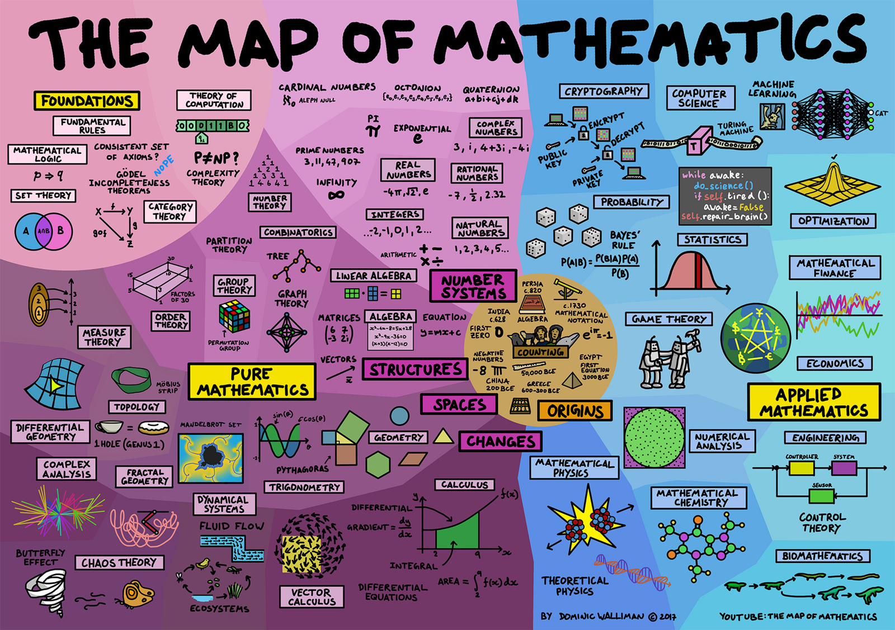

AI has dramatically changed the way scientists, including myself, practice science. In the last few months alone, advances made by AI in mathematics and the physical sciences have prompted many to think critically about the role we play in scientific research. Some have dubbed this new science "[Physics 2.0](https://www.anthropic.com/research/vibe-physics)".

The mathematicians [fell to AI](https://arxiv.org/pdf/2608.16753) first. Of course, many actually fell before them: the artists fell, along with the writers, and even computer scientists (glorified writers as they are). But to be impartial, we should remember those who fell to the computer scientists as well: [human calculators](https://www.popularmechanics.com/space/rockets/a24429/hidden-figures-real-story-nasa-women-computers/), data-entry clerks, and even the [pin boys](https://www.nytimes.com/2014/05/25/jobs/on-work-strikes-spares-and-bruised-shins.html)! And let's not forget who fell to the human calculators—the *moon*, who welcomed her first visitors during the Apollo missions, propelled by calculations performed by these very calculators. I will remind you that many frontiers fell to human ingenuity long before we worried about machines stealing our success.

But when the mathematicians fell, I believe the world shook like it hadn't before. In many ways, mathematics research has always represented the frontier of human thought. All aspects of human civilization have benefited from mathematical discovery; arithmetic enabled early civilizations, geometry enabled engineering, and calculus (once again) got us to the moon. But we have long since departed from mathematical discoveries that can easily be visualized or conjured through human intuition. Modern mathematics rests on innumerable layers of abstraction. This abstraction has been imperative to the development of modern mathematics. It is also what made it fall.

  <em>The <a href="/images/map_of_mathematics.jpg">Map of Mathematics</a> by Dominic Walliman, showing how the subfields of mathematics are related.</em>

Mathematics is particularly well suited to AI. Unlike the physical sciences, its truths can be established through logic alone, without the need for experiments or observations. And AI has become remarkably good at navigating the layers of abstraction that make modern mathematics so difficult for humans to master. Recent advances, from performances at the level of International Mathematical Olympiad gold medalists to AI-assisted progress on Millennium Prize problems, have begun to blur the distinction between human and machine mathematical reasoning. The mathematicians have not been replaced, but they must now grapple with "Mathematics 2.0": a world where a swarm of 10,000 agents works for weeks, spending millions of dollars to solve a problem whose prize would earn them only a million back. A world where 700 important discoveries are released at once in a pre-IPO publicity stunt, and a [LEAN-compilable proof](https://lean-lang.org/) is taken as the word of God.

  <em>A visualization of a solution to the Navier–Stokes equations, the subject of one of the Millennium Prize problems. The solution was obtained through a coordinated effort of roughly 10,000 AI agents over the course of the course of a week, consuming roughly 430 billion tokens. </em>

I started my career doing Physics 1.0. Code was written by hand, painstakingly sorting through Stack Overflow articles to resolve a bug buried deep within a codebase. Problem sets took hours upon hours to complete—sifting through textbooks and similar problems, lecture notes, old and obscure papers found on the internet, and by *asking each other for help*. Calculations in research had no such guidance for checking an end result; final results were sanity-checked through their physical dimensions, limiting behavior, and by simply wondering, "does this make sense?". Much of this struggle, I would argue, has been robbed from us. Other struggles have easily taken their place, but what has been more difficult to replicate in Physics 2.0 is the satisfaction of Physics 1.0.

And it is this satisfaction that leaves me so conflicted as I continue my career in physics. As grueling as Physics 1.0 was in some aspects (and I can't even begin to imagine how difficult Physics 0.5 was), *it made me feel like a scientist*. There was satisfaction in finally figuring out that bug, getting the first big result of a project you initiated from nothing, or finally arriving at a short and pretty expression for a blasphemous integral. Science has never promised to reward us for how hard we worked, but I think many of us believe that it should. And much of the satisfaction that came from that struggle has been lost in the name of Physics 2.0.

And yet, these tools are truly accelerating the way we do science. One shouldn't measure scientific progress in papers, but one will continue to do so regardless. The arXiv, the world's largest preprint repository for scientific research, received 178,329 submissions in 2020, 284,486 in 2025, and a staggering 39,257 in October 2026 alone, nearly double the number from the same month two years prior. The flood of papers has become so overwhelming that, as of October 2026, arXiv has [imposed a limit](https://blog.arxiv.org/2026/10/01/updated-rate-limit-policy/) of two new submissions per submitting author per month. Of course, more papers do not necessarily mean more discoveries, and the ease of producing scientific manuscripts is itself part of the problem. But the potential for genuine scientific progress is undeniable. Most recently, Physics 2.0 has [allegedly proven](https://openai.com/index/building-scientific-understanding-with-academic-communities/) the existence of a four-dimensional quantum Yang–Mills theory, addressing part of the sole Millennium Prize problem pertaining to quantum field theory, though not yet establishing the required mass gap.

  <em>arXiv monthly submissions since its founding in 1991, reaching a record 40,363 in September 2026.</em>

A *good* physicist would celebrate the accelerated scientific discoveries we will see thanks to these tools. But the *real* physicist in me mourns the days of Physics 1.0 and versions previous. Physics 1.0 gave the glory to the person; machines were still used, but the *thinking* was all ours. The calculations took minutes and hours instead of seconds, and this was enough for us to [feel big and smart and like a physicist](https://terrytao.wordpress.com/2026/10/15/why-are-we-even-doing-all-this/). But as I experience this dread now, I can't help but wonder if this is how more senior physicists felt watching us young physicists symbolically solve integrals in Mathematica that they once had to page through books of integrals to evaluate. Did they feel any more glory than I did?

My thoughts on Physics 2.0 vary by the day. But the feeling I shamelessly cannot shake, even as I oscillate between existential dread and absolute excitement, is *anger*. These tools have surpassed my abilities, and those of some of the brightest among us, without the blood, sweat, tears, and **time** we spent. They make discoveries without the rush of endorphins that has propelled generations of physicists to sacrifice their 20s for an education, move from one position to another for [measly chances](https://www.aps.org/careers/advice/faculty-doctoral-research-institutions) at a tenure-track job, and pursue scientific discovery for both the intellectual pursuit and the selfish desire to feel like you're doing something greater than yourself. There is something deeply frustrating about watching a machine effortlessly accomplish what you spent years learning to do. And perhaps even more frustrating is knowing that, from the perspective of science itself, none of that effort ever mattered. The discovery is no less valuable because a machine made it.

I do not know nor feel qualified to speak on what the future holds for us physicists, either in terms of scientific discovery or our role in the scientific method. These are very uncertain times. And when I feel myself drowning in the noise of it all, it has helped to remember a sentiment I started this essay with.  Physics may fall, but so did computer science. And if computer scientists fell, we remember that the human calculators fell to them. And then the moon fell to them. The moon fell to humanity.
